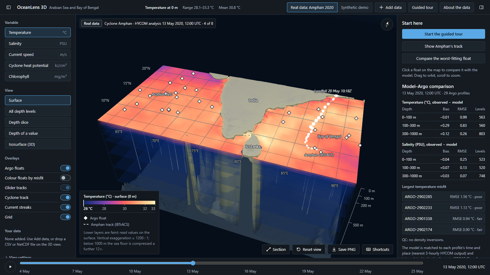
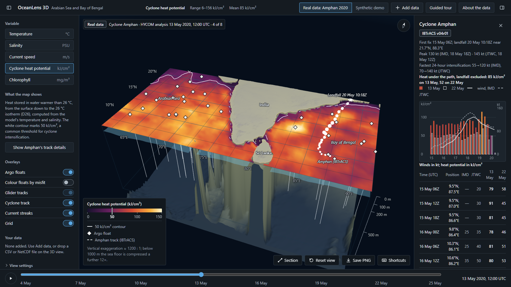
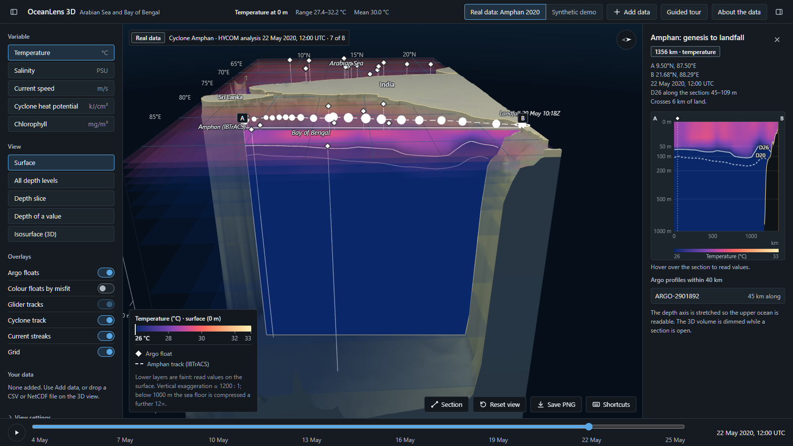
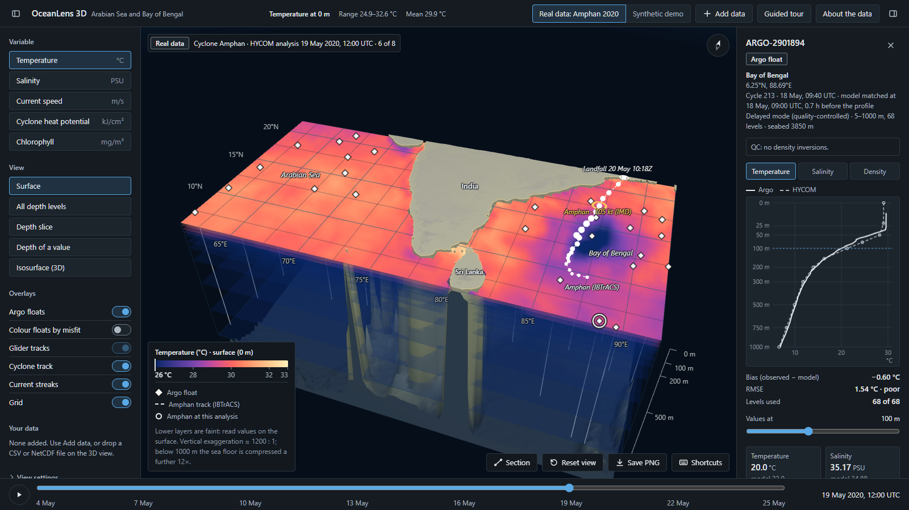

# OceanLens 3D

**Interactive 3D viewer for ocean model output and Argo floats, in one offline HTML file.**

[](https://github.com/Rehaan15790/OceanLens-3D/actions/workflows/ci.yml)




OceanLens 3D puts ocean model fields, Argo float profiles and a cyclone track into one 3D scene that you can slice,
probe and compare. It covers the Arabian Sea and the Bay of Bengal (6–22°N, 61–92°E, 0–1000 m).

It was built by **Team ByteForge** for Smart India Hackathon 2026, problem statement 26067 (problem owner: INCOIS).
It is a student prototype and is not affiliated with or endorsed by INCOIS or the Ministry of Earth Sciences.

## Try it

1. Download [`OceanLens3D.html`](https://github.com/Rehaan15790/OceanLens-3D/raw/main/OceanLens3D.html) (about 3.4 MB).
2. Double-click it. No install, no server, no internet connection.
3. Press **Start the guided tour** for an 8-step walkthrough, or `?` for the keyboard shortcuts.

It needs WebGL with hardware acceleration: current Chrome, Edge or Firefox, or Safari 15 or later, on a laptop or
desktop screen. The automated tests run in Chromium-based browsers; Firefox and Safari have not been tested.

## Features

- **3D ocean fields:** temperature, salinity, current speed and cyclone heat potential on 11 levels from 0 to
  1000 m, over real sea-floor relief.
- **Five views:** surface, all depth levels, a depth slice, the depth of a value (for example the 26 °C isotherm,
  D26) and a marching-cubes isosurface.
- **Vertical sections:** drag a line across the sea, or pick a preset such as Amphan's track.
- **Model vs observations:** click any Argo float to compare its profile with the model, matched in place and time,
  with bias, RMSE and a density-inversion QC check.
- **Cyclone analysis:** heat potential under Amphan's path before and after the storm, with IMD and JTWC winds.
- **Bring your own data:** drop Argo, glider, ERDDAP, CF NetCDF-3 or CSV files on the view. They are read in the
  browser and never uploaded.
- **Built for sharing:** a colour-bar editor, a timeline with playback, PNG export and a guided tour.
- **A data server and a plugin API** for institutions: REST, OGC WMS 1.3.0, WCS 2.0.1 and OPeNDAP DAP2, plus
  `window.OceanLens` for new instruments, variables, products and file formats.

<table>
  <tr>
    <td width="50%"><br><sub><b>Heat before Amphan.</b> Cyclone heat potential on 13 May 2020, with the 50 kJ/cm² contour and the track details.</sub></td>
    <td width="50%"><br><sub><b>The cold wake.</b> A section along the track after landfall, with D26 and D20 marked.</sub></td>
  </tr>
  <tr>
    <td colspan="2"><br><sub><b>Argo against HYCOM.</b> The worst-fitting float during the storm: observed profile solid, model dashed, with bias and RMSE.</sub></td>
  </tr>
</table>

## The data

There are two data modes, switched in the header.

- **Real data: Cyclone Amphan, May 2020 (a hindcast).** Eight HYCOM GOFS 3.1 analyses and 206 quality-controlled
  Argo profiles from 70 floats. BGC-Argo floats add chlorophyll (36 profiles from 13 floats) and oxygen (24 profiles
  from 9). The scene also has ETOPO1 relief and the IBTrACS track. HYCOM assimilates Argo, so the model–Argo
  comparison is a consistency check, not independent validation.
- **Synthetic demo:** analytic fields with synthetic floats and gliders, labelled as such. It is not a real ocean
  state.

The `samples/` folder has real files to try with **Add data**: Argo GDAC and ERDDAP downloads, a BGC-Argo profile and
two BoBBLE 2016 Seaglider files. There is also one synthetic CTD cast. `samples/README.md` gives each file's source
and citation.

## How it is built

The app is plain JavaScript on three.js r128, with no framework and no npm. A Python standard-library script inlines
the code, three.js and the data snapshot into the single HTML file, with a strict Content Security Policy. The data
pipeline, the server and the test harness are Python with numpy. The browser tests drive the built file in headless
Chromium through our own DevTools-protocol client.

Every number the app quotes is computed from the data at run time. An independent Python script recomputes the same
numbers, and a test fails if the two disagree.

## Documentation

| Document | What it covers |
| --- | --- |
| [Presenter guide](docs/PRESENTER_GUIDE.md) | Every feature, a 7-minute demo script and likely questions |
| [How the code works](docs/HOW_THE_CODE_WORKS.md) | The stack, a map of every source file, rendering, data, science, import, build, server and tests |
| [Testing](docs/TESTING.md) | The suites, the harness and the test contract with the app |
| [Deploying](docs/DEPLOY.md) | The single-file release, static hosting and the data server |
| [Server API](docs/API.md) | REST, WMS, WCS and OPeNDAP, with example URLs |
| [Extending](docs/EXTENDING.md) | Plugins, new variables, derived products and file formats |
| [Requirements](REQUIREMENTS.md) | Each requirement of problem statement 26067, mapped to the feature, files and test, with status |
| [Pipeline](data-pipeline/README.md) | How the real-data snapshot is fetched, cached and packed |

## Development

You need Python 3 (tested with 3.11 and 3.12) with numpy, and a Chromium-based browser (Edge, Chrome or Chromium)
for the browser tests.

```
python build.py                           # build into dist/OceanLens3D.html while working
python build.py --out OceanLens3D.html    # rebuild the shipped file
python build.py --check                   # the sources are consistent and the shipped file is up to date

python tools/check.py --quick             # unit, server and smoke suites: what CI runs
python tools/check.py                     # hygiene, build check, fresh build, every suite
python tools/run.py --list                # list the suites and tests

python server/serve.py                    # the app and its data at http://127.0.0.1:8080/
python data-pipeline/build_snapshot.py    # rebuild the data snapshot from the raw cache
```

The build is deterministic: the same sources always give the same bytes. A full test run has one known failure:
the `perf` load budget, which our runs miss because the test browser renders WebGL in software
(`docs/TESTING.md`). Rebuilding the snapshot needs the raw cache, or network access with `--fetch`
(`data-pipeline/README.md`).

### Repository layout

| Path | What it is |
| --- | --- |
| `OceanLens3D.html` | The shipped single file, generated by `build.py`. Do not edit it by hand. |
| `src/` | The app sources: `index.html` (markup and the script/style manifest), `css/`, `js/`, `assets/` |
| `vendor/` | three.js r128, unmodified (MIT; see `THIRD_PARTY_NOTICES.md`) |
| `data/` | The real-data snapshot, written by the data pipeline |
| `data-pipeline/` | Fetches, caches and packs HYCOM, Argo, BGC-Argo, ETOPO1 and IBTrACS; `ncio.py` reads and writes NetCDF classic |
| `server/` | The optional data server |
| `samples/` | Files to try with Add data |
| `tools/`, `tests/` | The test runner, the headless-browser client and the tests |
| `docs/` | The guides listed above |
| `deck/` | The pitch deck (HTML source; the PDF at the root is printed from it) and the SIH portal text |

## Limitations and next steps

- **One built-in case, no live data.** The real data is a hindcast of one past cyclone. There are no forecasts, and
  the pipeline is tied to the Amphan domain, its 11 depths and 4 model variables.
- **The 3D view draws only the snapshot in the page.** Model files given to the server reach other clients through
  REST, WMS, WCS and OPeNDAP, but are not drawn in 3D.
- **NetCDF-4 must be converted** to NetCDF-3 (for example `nccopy -k classic`) or exported as CSV.
- **The ADCP and HF radar plugins are tested on synthetic records only.**
- **Not yet connected:** the INCOIS Live Access Server and Copernicus Marine products; scheduled Argo, BGC-Argo and
  glider ingestion; authentication and rate limits, which belong in the institution's reverse proxy.
- **Possible uses, not implemented as features:** drift prediction for search and rescue (needs particle tracking),
  fishing-zone advisories, and climate monitoring.

## Data sources and citations

HYCOM GOFS 3.1 (HYCOM Consortium), Argo (Argo GDAC, doi:10.17882/42182), ETOPO1 (NOAA NCEI, doi:10.7289/V5C8276M) and
IBTrACS v04r01 (NOAA NCEI, doi:10.25921/82ty-9e16; winds from IMD and JTWC). The sample files come from the Argo GDAC
(its Ifremer mirror and Ifremer ERDDAP) and the OceanGliders GDAC (the BoBBLE experiment, 2016). The full
acknowledgements and citations are in `THIRD_PARTY_NOTICES.md`, `samples/README.md` and the app's About panel.

## Copyright and licence

Copyright © 2026 Team ByteForge. All rights reserved.

The source code is public so that it can be read and reviewed. It is **not** open source and no licence is granted:
you may not copy, modify, distribute, host, sell or otherwise use this code, the built `OceanLens3D.html` or the
deck, in whole or in part, without written permission from the authors. Viewing the repository on GitHub, and
forking it on GitHub as GitHub's Terms of Service allow, grants no other right. For licensing, open an issue or
contact the authors.

Third-party software and data included in the build keep their own licences and terms, listed in
`THIRD_PARTY_NOTICES.md`.
