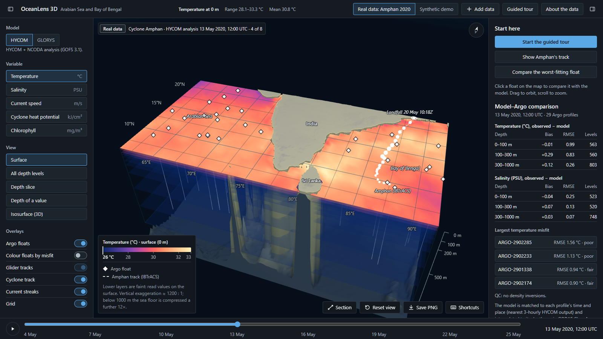
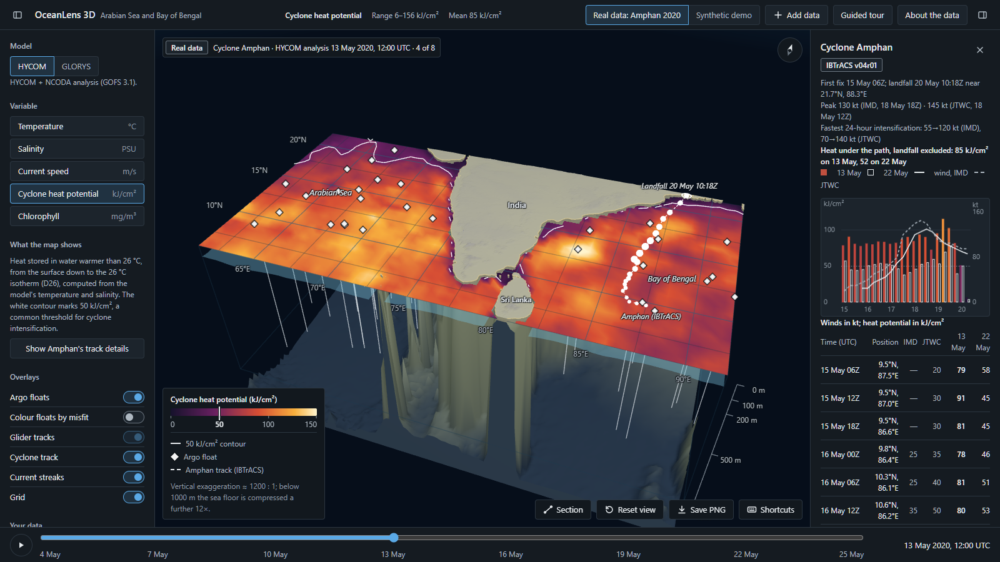
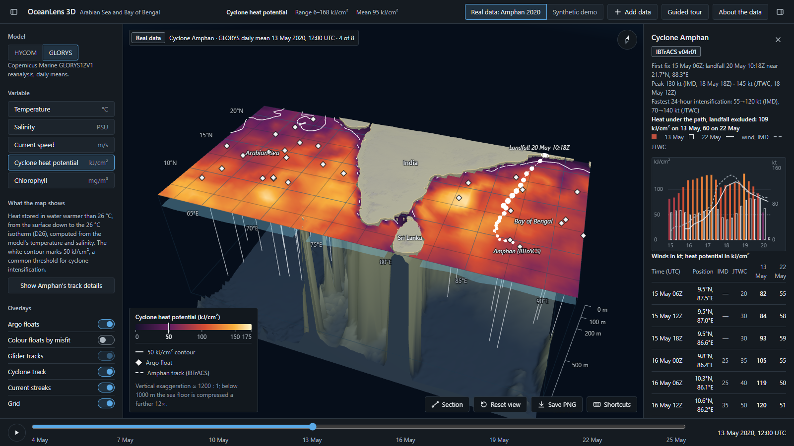
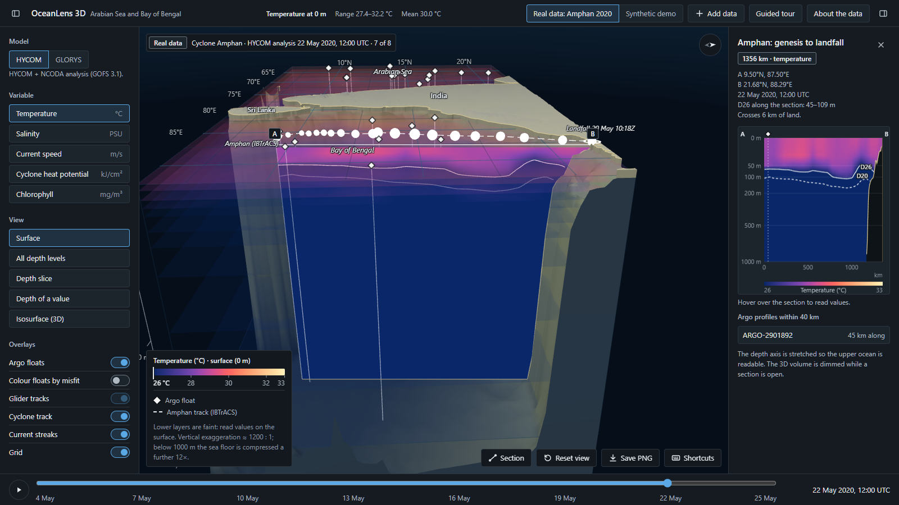
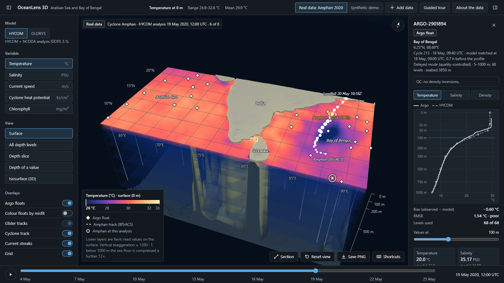
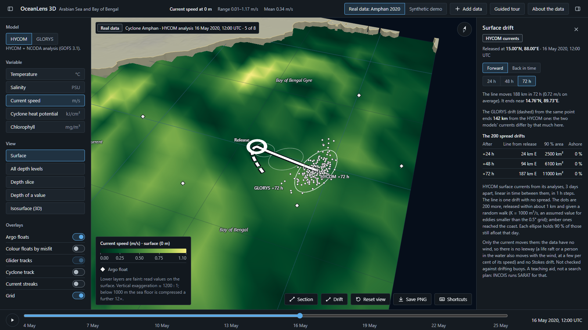
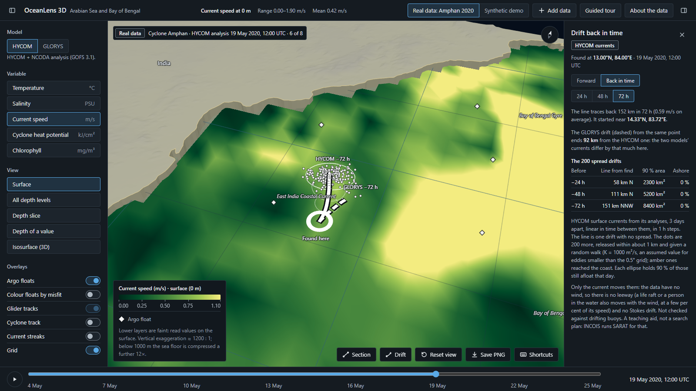

# OceanLens 3D

**Interactive 3D viewer for ocean model output and Argo floats, in one offline HTML file.**

[](https://github.com/Rehaan15790/OceanLens-3D/actions/workflows/ci.yml)




OceanLens 3D puts ocean model fields, Argo float profiles and a cyclone track into one 3D scene that you can slice,
probe and compare. It covers the Arabian Sea and the Bay of Bengal (6–22°N, 61–92°E, 0–1000 m), with three models to
switch between: HYCOM, Copernicus Marine GLORYS and INCOIS's IGORA reanalysis from the INCOIS Live Access Server.

It was built by **Team ByteForge** for Smart India Hackathon 2026, problem statement 26067 (problem owner: INCOIS).
It is a student prototype and is not affiliated with or endorsed by INCOIS or the Ministry of Earth Sciences.

## Try it

1. Download [`OceanLens3D.html`](https://github.com/Rehaan15790/OceanLens-3D/raw/main/OceanLens3D.html) (about 6 MB).
2. Double-click it. No install, no server, no internet connection.
3. Press **Start the guided tour** for an 8-step walkthrough, or `?` for the keyboard shortcuts.

It needs WebGL with hardware acceleration: current Chrome, Edge or Firefox, or Safari 15 or later, on a laptop or
desktop screen. The automated tests run in Chromium-based browsers. Firefox 157 was checked by hand on 14 October 2026
(every view, a float comparison, no console errors). Safari has not been tested.

## Features

- **3D ocean fields:** temperature, salinity, current speed and cyclone heat potential on 11 levels from 0 to
  1000 m, over real sea-floor relief.
- **Five views:** surface, all depth levels, a depth slice, the depth of a value (for example the 26 °C isotherm,
  D26) and a marching-cubes isosurface.
- **Vertical sections:** drag a line across the sea, or pick a preset such as Amphan's track.
- **Surface drift for search and rescue:** click the sea (`T`) to release an object; the model's surface currents
  carry it up to 72 h forward, or back in time to ask where something found there came from. 200 spread drifts give
  a 90 % search ellipse for each day and the share that reaches the coast, and the other model's drift from the same
  point shows how far the models disagree. Turn on **Drifting buoys** to release a drift where one of 12 real NOAA
  drifting buoys was, and see where the buoy really went.
- **Today's ocean forecast (served):** `build_forecast.py` puts the latest Copernicus Marine global forecast (the day
  before the run and the next 9 days) on the same map; the data server offers it as a case beside Amphan, under
  Data source, and `--reload` picks up each day's new run. Temperature, salinity, currents, heat potential, sections
  and the drift tool all work on it.
- **Three models:** HYCOM, the Copernicus Marine GLORYS12V1 reanalysis and INCOIS's own IGORA reanalysis, the two
  sources the problem statement lists (Copernicus Marine and the INCOIS LAS), switched with one click (or `M`). IGORA
  is the May 2020 monthly mean, exported from the INCOIS Live Access Server by the pipeline. The fields, comparisons and every number in the tour follow the model.
- **Model vs observations:** click any Argo float to compare its profile with the model, matched in place and time,
  with bias, RMSE and a density-inversion QC check. Four real RAMA moorings (NOAA PMEL) in the Bay of Bengal and the
  Arabian Sea are in the scene too: at 12°N 90°E the surface cooled 2.1 °C as Amphan passed (13 to 19 May), against
  1.2 °C in HYCOM and 1.0 °C in GLORYS.
- **Cyclone analysis:** heat potential under Amphan's path before and after the storm, with IMD and JTWC winds.
- **Fishing-zone indicator:** satellite SST fronts (OSTIA, 0.05°) and satellite chlorophyll (Copernicus-GlobColour,
  gap-free) on each day, and the cells that show both, the two signs behind potential fishing zone advisories. A
  teaching version of the idea, not an advisory.
- **Climate monitoring:** the satellite SST anomaly against the 1991–2020 normal of the same day, and every year's
  May mean since 1982 with its trend: about +0.26 °C per decade in the Bay of Bengal and +0.35 °C in the Arabian
  Sea. The Bay was about 1 °C above normal before Amphan and below normal in its wake.
- **Bring your own data:** drop Argo (core, B and S files), glider, ERDDAP, CF NetCDF-3 or NetCDF-4, or CSV files on
  the view. They are read in the browser, by the project's own NetCDF readers, and never uploaded.
- **Built for sharing:** a colour-bar editor, a timeline with playback, PNG export and a guided tour.
- **A data server and a plugin API** for institutions: REST, OGC WMS 1.3.0, WCS 2.0.1 and OPeNDAP DAP2, optional API
  keys and rate limits, plus `window.OceanLens` for new instruments, variables, products and file formats. A NetCDF
  model file given to the server that covers the map and the case's times joins the page's Model switch and is drawn
  in 3D, streamed from the server.

<table>
  <tr>
    <td width="50%"><br><sub><b>Heat before Amphan, HYCOM.</b> Cyclone heat potential on 13 May 2020, with the 50 kJ/cm² contour: about 85 kJ/cm² under the path.</sub></td>
    <td width="50%"><br><sub><b>The same day, GLORYS.</b> One click on Model: the Copernicus reanalysis puts about 109 kJ/cm² under the same path.</sub></td>
  </tr>
  <tr>
    <td width="50%"><br><sub><b>The cold wake.</b> A section along the track after landfall, with D26 and D20 marked.</sub></td>
    <td width="50%"><br><sub><b>Argo against HYCOM.</b> The worst-fitting float during the storm: observed profile solid, model dashed, with bias and RMSE.</sub></td>
  </tr>
  <tr>
    <td width="50%"><br><sub><b>Surface drift.</b> Released at 15°N, 88°E on 16 May: HYCOM carries it about 190 km east in 72 h; the dashed GLORYS drift ends about 140 km away.</sub></td>
    <td width="50%"><br><sub><b>Where did it come from?</b> Traced back 72 h from 13°N, 84°E on 19 May, with the 90 % search ellipse for each day.</sub></td>
  </tr>
</table>

## Example: a cyclone desk

The built-in case replays what a cyclone desk would have seen before and after Amphan, from data that existed then.

1. **Where is the heat?** Cyclone heat potential with its 50 kJ/cm² contour, and the D26 depth below it. On
   13 May 2020 the water under Amphan's path held about 85 kJ/cm² in HYCOM.
2. **How sure is that?** Press `M` for GLORYS: about 109 kJ/cm² under the same path. Both are far above the 50 mark,
   but they differ by a quarter, which is the spread a forecaster should keep in mind.
3. **Does the model agree with the floats?** Click the floats near the track: each opens its profile against the
   model column at the same place and time, with bias, RMSE and a QC check. Switch the model with the profile open
   to compare the same float with both.
4. **What did the storm leave behind?** A section along the track after landfall shows the cold wake: the surface
   about 2.3 °C cooler in HYCOM (1.6 °C in GLORYS) and the heat potential down to about 52 kJ/cm² (60 in GLORYS).
5. **Brief the team.** Export the view as a PNG, or send the single HTML file, which opens offline.

This is a hindcast: OceanLens has no forecasts or live data yet (see Limitations).

## The data

There are two data modes, switched in the header.

- **Real data: Cyclone Amphan, May 2020 (a hindcast).** Two models on the same 8 days: eight HYCOM GOFS 3.1
  analyses, and the Copernicus Marine GLORYS12V1 daily means centred on the same times, read straight from Copernicus
  Marine's native NetCDF-4 files. With them, 206 quality-controlled Argo profiles from 70 floats. BGC-Argo floats add
  chlorophyll (36 profiles from 13 floats) and oxygen (24 profiles from 9). The scene also has ETOPO1 relief and the
  IBTrACS track. Both models assimilate Argo, so the model–Argo comparison is a consistency check, not independent
  validation. Over all 206 profiles the HYCOM temperature RMSE is 1.07 °C in the top 100 m and 0.30 °C from 300 to
  1000 m (the table is in `docs/PRESENTER_GUIDE.md`).
- **The models disagree, as models do:** under Amphan's future path on 13 May, HYCOM holds 85 kJ/cm² of cyclone heat
  potential and GLORYS 109. Below 300 m GLORYS is closer to the floats (RMSE 0.22–0.28 °C against 0.26–0.37 °C).
- **Synthetic demo:** analytic fields with synthetic floats and gliders, labelled as such. It is not a real ocean
  state.

The `samples/` folder has real files to try with **Add data**: Argo GDAC and ERDDAP downloads, BGC-Argo profiles
(two of them NetCDF-4 S-files as the data centres serve them) and two BoBBLE 2016 Seaglider files. There is also one synthetic CTD cast. `samples/README.md` gives each file's source
and citation.

## How it is built

The app is plain JavaScript on three.js r128, with no framework and no npm. A Python standard-library script inlines
the code, three.js and the data snapshot into the single HTML file, with a strict Content Security Policy. The data
pipeline, the server and the test harness are Python with numpy; xarray is an optional NetCDF backend (`--engine
xarray`). The browser tests drive the built file in headless
Chromium through our own DevTools-protocol client.

Every number the app quotes is computed from the data at run time. An independent Python script recomputes the same
numbers, and a test fails if the two disagree.

## Documentation

| Document | What it covers |
| --- | --- |
| [Presenter guide](docs/PRESENTER_GUIDE.md) | Every feature, a 7-minute demo script and likely questions |
| [How the code works](docs/HOW_THE_CODE_WORKS.md) | The stack, a map of every source file, rendering, data, science, import, build, server and tests |
| [Testing](docs/TESTING.md) | The suites, the harness and the test contract with the app |
| [Deploying](docs/DEPLOY.md) | The single-file release, static hosting and the data server |
| [Server API](docs/API.md) | REST, WMS, WCS and OPeNDAP, with example URLs |
| [Extending](docs/EXTENDING.md) | Plugins, new variables, derived products and file formats |
| [Requirements](REQUIREMENTS.md) | Each requirement of problem statement 26067, mapped to the feature, files and test, with status |
| [Pipeline](data-pipeline/README.md) | How the real-data snapshot is fetched, cached and packed |

## Development

You need Python 3 (tested with 3.11 and 3.12) with numpy, and a Chromium-based browser (Edge, Chrome or Chromium)
for the browser tests.

```
python build.py                           # build into dist/OceanLens3D.html while working
python build.py --out OceanLens3D.html    # rebuild the shipped file
python build.py --check                   # the sources are consistent and the shipped file is up to date

python tools/check.py --quick             # unit, server and smoke suites: what CI runs
python tools/check.py                     # hygiene, build check, fresh build, every suite
python tools/run.py --list                # list the suites and tests

python server/serve.py                    # the app and its data at http://127.0.0.1:8080/
python data-pipeline/build_snapshot.py    # rebuild the data snapshot from the raw cache
```

The build is deterministic: the same sources always give the same bytes. The `perf` load budget depends on the
machine, because the test browser renders WebGL in software: it fails on our slower machine with no GPU and passes
on a fast desktop. Measured load times and frame rates, with and without a GPU, are in `docs/TESTING.md`.
Rebuilding the snapshot needs the raw cache, or network access with `--fetch` (`data-pipeline/README.md`).

### Repository layout

| Path | What it is |
| --- | --- |
| `OceanLens3D.html` | The shipped single file, generated by `build.py`. Do not edit it by hand. |
| `src/` | The app sources: `index.html` (markup and the script/style manifest), `css/`, `js/`, `assets/` |
| `vendor/` | three.js r128, unmodified (MIT; see `THIRD_PARTY_NOTICES.md`) |
| `data/` | The real-data snapshot, written by the data pipeline |
| `data-pipeline/` | Fetches, caches and packs HYCOM, GLORYS, Argo, BGC-Argo, ETOPO1 and IBTrACS; `ncio.py` reads and writes NetCDF classic, `nc4.py` reads NetCDF-4 |
| `server/` | The optional data server |
| `samples/` | Files to try with Add data |
| `tools/`, `tests/` | The test runner, the headless-browser client and the tests |
| `docs/` | The guides listed above |
| `deck/` | The pitch deck (HTML source; the PDF at the root is printed from it) and the SIH portal text |

## Limitations and next steps

- **One built-in case.** The single file holds a hindcast of one past cyclone. A server can also show the latest
  Copernicus forecast, but the forecast case has no floats, storm track, waves, storm surge or sea level yet, and
  every case is tied to the same map, 11 depths and 4 model variables.
- **The 3D view is tied to the case's grid and times.** A model file given to the server is drawn in 3D only when it
  covers the whole map and has a time within 12 h of each of the 8 analyses; it is then put on the 0.5° grid and 11
  levels. Other files reach clients through REST, WMS, WCS and OPeNDAP only.
- **GLORYS has daily means,** so floats are compared with the nearest of the 8 days; HYCOM is matched to each float's
  own time. GLORYS gives potential temperature; the comparison turns it into in-situ temperature at each float
  level's pressure (UNESCO 1983), so both sides are the same quantity.
- **NetCDF-4 compressed with szip or zstd** is not read; convert it (for example `nccopy -k classic`) or export CSV.
- **The ADCP and HF radar plugins are tested on synthetic records only** (RAMA had no ADCP data in the map in May
  2020; the moorings' near-surface current meters are shown as current speed).
- **Not yet connected:** the INCOIS Live Access Server and Copernicus Marine's other products (biogeochemistry,
  forecasts); scheduled Argo, BGC-Argo and glider ingestion. The server's API keys and rate limits are simple
  (shared keys, one limit per client address); TLS and user accounts belong in the institution's reverse proxy.
- **The drift tool moves objects with the surface current only.** The data have no wind, so there is no leeway
  (a life raft or a person in the water also moves with the wind) and no Stokes drift; currents are 3 days apart
  and linear in time between them; the random-walk diffusivity is an assumed value. Checked against 12 real drifting
  buoys (61 releases): after 72 h the GLORYS line ends a median 31 km from the buoy and the HYCOM line 55 km, against
  about 46 km had the object stayed put. HYCOM's instantaneous analyses 3 days apart do no better than standing still
  here; GLORYS's daily means do. It is a teaching aid, not a search plan (INCOIS runs SARAT for that).
- **The fishing-zone indicator is simplified:** two thresholds on 0.5° cells (an SST front of at least 0.3 °C per
  10 km, chlorophyll of at least 0.3 mg/m³), from gap-free satellite fields in which clouds are interpolated. It has
  not been checked against catches or against INCOIS's own advisories.
- **Climate monitoring covers sea-surface temperature only,** for the 8 analysis days of May each year, in two boxes.

## Data sources and citations

HYCOM GOFS 3.1 (HYCOM Consortium), GLORYS12V1 (E.U. Copernicus Marine Service Information,
GLOBAL_MULTIYEAR_PHY_001_030, doi:10.48670/moi-00021), Argo (Argo GDAC, doi:10.17882/42182), ETOPO1 (NOAA NCEI, doi:10.7289/V5C8276M) and
IBTrACS v04r01 (NOAA NCEI, doi:10.25921/82ty-9e16; winds from IMD and JTWC) and the NOAA Global Drifter Program
hourly drifter data (doi:10.25921/x46c-3620), RAMA moorings (NOAA PMEL GTMBA, McPhaden et al. 2009), and
Copernicus Marine OSTIA SST and GlobColour chlorophyll. The sample files come from the Argo GDAC
(its Ifremer mirror and Ifremer ERDDAP) and the OceanGliders GDAC (the BoBBLE experiment, 2016). The full
acknowledgements and citations are in `THIRD_PARTY_NOTICES.md`, `samples/README.md` and the app's About panel.

## Copyright and licence

Copyright © 2026 Team ByteForge. All rights reserved.

The source code is public so that it can be read and reviewed. It is **not** open source and no licence is granted:
you may not copy, modify, distribute, host, sell or otherwise use this code, the built `OceanLens3D.html` or the
deck, in whole or in part, without written permission from the authors. Viewing the repository on GitHub, and
forking it on GitHub as GitHub's Terms of Service allow, grants no other right. For licensing, open an issue or
contact the authors.

Third-party software and data included in the build keep their own licences and terms, listed in
`THIRD_PARTY_NOTICES.md`.
