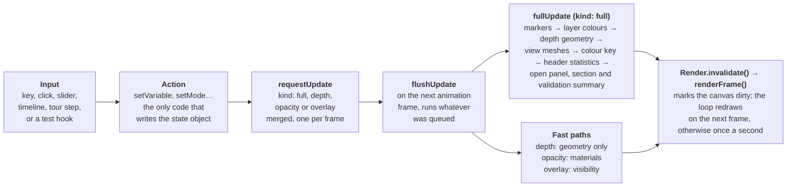

# How the code works

A walkthrough of the code, the tools behind it and how each part works. For presenting the app, see
[PRESENTER_GUIDE.md](PRESENTER_GUIDE.md).

## The tech stack

The whole project uses only two third-party libraries: **three.js** in the browser and **numpy** in Python. Everything else is written by hand on the browser's and Python's built-in features. That is why the app ships as one offline file.

### Languages and libraries

| Piece | What we used | Why |
| --- | --- | --- |
| 3D graphics | **three.js r128** (MIT), inlined into the page | A thin layer over WebGL: scenes, cameras, meshes, textures, lights. Pinned to one version so the file never changes under us |
| App code | **Plain JavaScript**, 41 classic script files (about 6,900 lines) sharing one global scope | No npm, no bundler, no framework: nothing to install, and the build stays a simple concatenation |
| Styling | **Plain CSS**, 9 files with design tokens in `tokens.css` | Dark theme, consistent spacing and colours, no CSS framework |
| Charts in the panels | **HTML canvas 2D**, drawn by hand in `charts.js` | Profile, section and track charts without a chart library |
| Build, server, pipeline, tests | **Python 3** (3.11/3.12) standard library | Runs anywhere Python does |
| Numerical work | **numpy** | Grids, averaging, NetCDF arrays in the pipeline and server |
| Browser automation | Our own **Chrome DevTools Protocol** client (`tools/cdp.py`) with a hand-written WebSocket | Drives headless Edge or Chrome for tests without Selenium or Playwright |
| CI | **GitHub Actions**, one Linux job, actions pinned to exact commits | Runs the quick checks on every push to `main` |

### Data services the pipeline downloads from

| Data | Service | Protocol |
| --- | --- | --- |
| Ocean model (temperature, salinity, currents) | HYCOM GOFS 3.1, `tds.hycom.org` THREDDS | OPeNDAP ASCII |
| Argo profiles | Ifremer ERDDAP, `ArgoFloats` | ERDDAP tabledap CSV |
| BGC-Argo chlorophyll and oxygen | Ifremer ERDDAP, `ArgoFloats-synthetic-BGC` | ERDDAP tabledap CSV |
| Sea floor and coast | ETOPO1 on NOAA's `upwell.pfeg.noaa.gov` ERDDAP | ERDDAP griddap CSV |
| Cyclone track | IBTrACS v04r01 from NOAA NCEI | CSV download |

### File formats

- **JSON:** the data snapshot (`data/amphan-2020.json`), with the big arrays packed as base64 16-bit integers.
- **NetCDF-3:** read in the browser for imports, and read and written in Python by our own `ncio.py` (no netCDF4 library).
- **CSV / TSV:** imports, ERDDAP downloads and server exports.
- **PNG:** Save PNG in the app, and WMS map images from the server (encoded by hand with `zlib`).

## Code map

Every JavaScript file lives in `src/js/` and has one job, stated in a comment at its top. The table follows the order the page loads them, grouped by layer.

| Layer | File | What it does |
| --- | --- | --- |
| Safety net | `boot-guard.js` | Runs first, before three.js. Creates `window.__ol` (status and test hooks), checks WebGL, catches start-up errors and shows a message instead of a dead splash. Written in old-style JavaScript so it works even in old browsers |
| Setup | `config.js` | Parses the embedded snapshot, defines the grid (11 depths, 0.5° cells), variable metadata and the shared `state` object |
| | `palettes.js` | 256-colour lookup tables for each colour ramp, generated by `make_palettes.py` |
| | `plugins.js` | The `window.OceanLens` registry: variables, products, instruments, formats, datasets, events |
| | `plugins/ctd.js`, `mooring.js`, `adcp.js`, `hfradar.js` | Example instrument plugins |
| Helpers | `fmt.js` | Formatting: UTC dates, coordinates, units, the true minus sign, HTML escaping |
| | `geo.js` | Map projection (lat/lon to 3D x/z), the grid, ETOPO1 relief, land and seabed masks, distances |
| Data | `data-source.js` | One interface over the two data modes, so the rest of the app doesn't care which is active |
| | `ocean.js` | The science: equation of state, model values at observation points, misfit statistics, heat potential |
| | `data-synthetic.js` | Generates the synthetic ocean, floats and gliders from formulas |
| | `data-real.js` | Decodes the HYCOM fields, Argo profiles and Amphan track from the snapshot |
| | `facts.js` | Computes every number shown in captions and panels, once |
| 3D | `render.js` | The only file that creates three.js materials: colour conversion, palette ramps, draw order, fog, test hooks |
| | `scene.js` | Renderer, background, lights, fog and the frame loop |
| | `camera.js` | Orbit camera for mouse, touch and keyboard |
| | `terrain.js` | Lat/lon grid, domain box, ETOPO1 sea floor with side walls, land |
| | `labels.js` | Place names and grid labels positioned on screen |
| | `volume.js` | One coloured plane per model level; the surface, layers, slice, depth-of-value and heat-map meshes |
| | `isosurface.js` | Marching cubes for the Isosurface (3D) view |
| | `track.js` | The cyclone track line and fixes |
| | `section.js` | Vertical sections: drawing the line, cutting the curtain |
| | `flow.js` | Current arrows and streaks |
| | `markers.js` | Float, glider and instrument markers, their depth stems, and clicking them |
| UI | `charts.js` | Canvas charts in the panels and the colour key |
| | `controls.js` | Wires buttons and sliders to **actions**, the only code allowed to change `state` |
| | `timeline.js` | The time slider and playback |
| | `tour-steps.js`, `tour.js` | The eight tour steps and the code that runs them |
| | `panels.js` | Right-hand panels: validation summary, float profile, track details |
| Import | `import/csv.js` | Parses comma, tab or semicolon text and guesses which column is which |
| | `import/netcdf3.js` | A NetCDF-3 reader written from scratch |
| | `import/import.js` | File → detect format → parse → dataset → add to the map |
| | `import/formats.js` | Readers for Argo, EGO glider, ERDDAP and CF files, with QC and units |
| | `import-ui.js` | The Add data dialog, drag-and-drop and the Your data list |
| Chrome | `shell.js` | Collapsible panels, the small-screen notice, dialog focus, filling numbers into the About text |
| | `hover.js` | The value readout under the mouse pointer |
| | `export.js` | Save PNG: composes the view, labels, key and caveat into one image |
| | `hotkeys.js` | Keyboard shortcuts |
| Start | `main.js` | Loads last: the update logic, start-up and the animation loop |

## Startup

The page boots in a fixed order: every script runs top to bottom as the browser reads it, and `main.js` comes last to start the app. If anything fails on the way, the splash shows the error instead of hanging.

1. **`boot-guard.js` runs first.** It creates `window.__ol`, sets `<html data-state="loading">`, installs error handlers and checks for WebGL. With no WebGL, it shows a message and stops.
2. **three.js loads** (inlined from `vendor/three.r128.min.js`).
3. **`config.js` reads the data.** The snapshot sits in the page as a `<script type="application/json">` block. It is parsed, and its schema version is checked so a mismatched file can never be misdrawn.
4. **Registries and helpers load:** palettes, the plugin API with the built-in variables and instruments, then formatting and geography.
5. **Data decodes.** `data-real.js` unpacks the base64 arrays into typed arrays; `data-synthetic.js` builds its fields; `facts.js` computes the numbers the captions need.
6. **The 3D scene builds once:** renderer, lights, terrain, sea floor, labels, the level meshes, markers, track.
7. **UI wiring attaches** event handlers to every button, slider and key.
8. **`main.js` calls `boot()`:** size the canvas, set the camera home, set colour ranges, run one full update, expose the test hooks, then start the animation loop.
9. **First frame drawn.** `__ol._markReady()` flips `data-state` to `ready`, and the splash buttons change from "Loading data…" to Enter.

**Rendering on demand.** The animation loop runs every frame but only redraws when something called `Render.invalidate()`: a camera move, an update, the current streaks animating. Otherwise it redraws once a second. This keeps laptops cool and fans quiet during a long demo.

**Hidden tab or dialog:** when a dialog covers the view, drawing pauses and resumes when it closes.

## State and updates

All app state lives in one object, `state` (variable, view, depth, time, iso-value, colour range, overlays, open panel). Only **actions** may change it, and every action ends by asking for an update.



Example: pressing `2` makes `hotkeys.js` call `setVariable('sal')`; a full update then gives new colours, a new key and readout, and one redraw.

- **Why one update per frame:** dragging a slider fires dozens of events a second. `requestUpdate` merges them, so the expensive rebuild runs once per frame, not once per event.
- **Why fast paths:** dragging Depth stretch or Lower layers only needs geometry or transparency changed, so it skips recolouring every mesh.
- **Why one funnel:** if something is stale on screen after a click, there is exactly one place to look. This is how the rendering bugs found during debugging were tracked down.
- **Test hooks:** `window.__ol.actions` exposes every action for the automated tests, which call them and check the result immediately.

## 3D rendering

The ocean is drawn as a stack of flat coloured sheets, one per model level, inside a box of real sea-floor relief. The colours are computed on the graphics card from the data values, so changing the colour ramp or range is instant.

**Coordinates.** `geo.js` maps latitude and longitude to x and z (east is +x, north is −z) and depth to −y, scaled by the Depth stretch slider. The model grid is 33 × 63 points (6–22°N, 61–92°E at 0.5°).

| Part | File | How it works |
| --- | --- | --- |
| Level sheets | `volume.js` | One mesh per depth: a 33 × 63 grid of points, two triangles per cell. Each vertex carries the raw data value |
| Colouring | `render.js` | A custom shader looks up each pixel's value in a 256-colour ramp texture. Linear or log10 scaling happens per pixel, so colour between grid points is the colour of the interpolated value. Changing range, ramp or scale changes a uniform only; no geometry is rebuilt |
| Depth of a value | `volume.js` | For each water column, walk down the levels until the value is crossed (`firstCrossing`) and interpolate the depth. Columns that never cross above the sea floor are left as gaps |
| Isosurface (3D) | `isosurface.js` | **Marching cubes** over depth × lat × lon. The 256-case table is generated when the page loads, choosing joins so neighbouring cubes never leave cracks. Cells touching land are skipped, and the surface is lit from a fixed direction so its relief reads |
| Sea floor and land | `terrain.js` | ETOPO1 relief sampled every 0.1°, with side walls so the block looks solid; below 1000 m it is compressed 12× |
| Current streaks | `flow.js` | Particles carried along by the model's u and v velocities, drawn as white comet streaks with a dark edge so any colour shows them |
| Current arrows | `flow.js` | Up to 400 instanced cones on the depth slice; length shows speed |
| Floats and instruments | `markers.js` | Constant-size screen marks with a dark outline and a stem showing each profile's depth range. Clicks are matched on screen within a few pixels |
| Labels | `labels.js` | Place names and grid labels projected from 3D to screen position each frame |

**Draw order.** Translucent sheets must be drawn back to front or they blend wrongly. `render.js` assigns every kind of object a fixed band: stems first, then the levels deepest first, then translucent surfaces, the TCHP map, surface lines, streaks, markers and the selection ring on top. Two of the rendering bugs fixed during debugging were objects in the wrong band.

**One owner for materials.** Only `render.js` creates three.js materials, so colour, fog and transparency rules live in one place.

## Data layer

The data is one JSON file built into the page, about 2.3 MB. The app never asks it directly; everything goes through one function, `getVal(variable, lat, lon, depth, time)`, so the real and synthetic oceans are interchangeable.

### The snapshot (`data/amphan-2020.json`)

| Key | Holds | Packing |
| --- | --- | --- |
| `schema`, `meta` | Version, grid (33 × 63, 0.5° from 6°N 61°E), 11 depths, 8 times, variable list, scale factors, sources | Plain JSON |
| `model` | Temperature, salinity, u, v for every time, level and grid point: about 1.46 million values | 16-bit integers in base64. Each variable has an offset and step, e.g. temperature = 15 + q × 0.001 °C; −32768 means missing |
| `mask` | Which cells hold real model water | One bit per cell, base64 |
| `argo` | 206 profiles on fixed levels, plus BGC chlorophyll and oxygen, plus HYCOM at each profile's own place and time | Same 16-bit packing |
| `track` | Amphan's six-hourly IBTrACS fixes with IMD and JTWC winds | Plain JSON |

Packing as 16-bit integers halves the size compared with 32-bit floats and keeps 0.001 °C precision, far finer than the model's own accuracy.

### Reading values

- **`data-real.js`** decodes the base64 into a `Float32Array` once at start-up, laid out as [time][variable][level][lat][lon].
- **`realAt()`** samples it: bilinear between the four surrounding grid points, then linear between the two levels around the depth. Every hover readout, section and profile comparison uses it.
- **`data-synthetic.js`** answers the same questions from formulas: a warm mixed layer over a logistic thermocline, a fresher Bay, rotating currents. It was checked at 2 m steps to have no density inversions, except one deliberate bad salinity sample for the QC demo.
- **`data-source.js`** holds a table per mode: the sampling functions, the instruments, the track, and every piece of text that differs between modes (badges, captions, file names). Switching mode changes one variable, `dataMode`.

### Facts

`facts.js` computes every number the app quotes (heat before and after Amphan, D26 percentiles, Argo counts, RMSE ranges) once, from the data. Captions and the About panel read `facts()`, never their own arithmetic. `data-pipeline/facts_reference.py` recomputes the same numbers in Python straight from the JSON, and a test fails if the two disagree.

## Science code

The oceanography lives in `ocean.js`, each formula taken from a published method and checked against its published test values.

### Seawater density (UNESCO EOS-80)

`seawaterDensity(S, T)` is the one-atmosphere equation of state: a polynomial in salinity and temperature. It is verified against the published check values (S = 35, T = 0 → 1028.1063 kg/m³; S = 35, T = 25 → 1023.3431 kg/m³). `sigmaT` is density minus 1000.

### Cyclone heat potential and D26

`tchpColumn` follows Leipper and Volgenau (1972) and Goni et al. (2009):

```math
Q = c_p \int_{0}^{D26} \rho(S,T)\,(T - 26)\,dz
```

- It steps down the column in 2 m steps, adding density × (T − 26) × 2 m while the water is warmer than 26 °C.
- At the step where temperature drops below 26 °C it adds the last partial triangle and records that depth as **D26**.
- It returns kJ/cm², with cp = 4000 J/(kg·K). Some operational products use 4178, about 4.5 % higher; the About panel says so.
- A surface already at or below 26 °C gives 0; a column warm all the way to the sea floor has no D26; a data gap gives no value rather than a guess.

The heat map runs this for every grid column at the current time (`tchpGrid`). The 50 kJ/cm² contour is drawn by `contourSegments` (marching squares).

### Comparing floats with the model

1. **`modelAtObs`** gets the model at the float's own depths. Real profiles carry HYCOM sampled at their own place and time (nearest 3-hourly output), stored by the pipeline; otherwise the nearest analysis is interpolated.
2. **`misfit`** pairs each good observed level with the model: difference = observed − model. Flagged levels are skipped.
3. **`summarize`** turns the differences into **bias** (mean difference) and **RMSE** (root-mean-square difference), with the count of levels used.
4. **Rating:** temperature RMSE under 0.5 °C is good, up to 1.0 °C fair, above that poor; salinity uses 0.15 and 0.30 PSU.

This follows GODAE Class 4 verification, the standard way forecast centres compare models with profiles.

### Quality control

`inversionFlags` is the **density-inversion test** from the Argo real-time QC manual (test 14). Going down the profile, a level lighter than the one above by more than 0.03 kg/m³ is flagged, and going up, a level denser than the one below. A single dense spike gets flagged itself, not the good levels around it. Flagged levels are drawn but left out of bias and RMSE.

### Other derived quantities

- **Sound speed:** Mackenzie (1981), from temperature, salinity and depth.
- **Pressure:** from depth and latitude, used to convert Argo pressure (dbar) to depth when importing.

## Import and plugins

Imports run entirely in the browser: the file is read into memory with the File API and never sent anywhere. Each step is a separate, replaceable piece.

### The import pipeline (`import/import.js`)

1. **Size check:** files over 50 MB are refused with advice to subset them.
2. **Sniff the first bytes:** `CDF` means NetCDF-3; the HDF5 signature means NetCDF-4, which gets the "convert with nccopy" message; anything else is treated as text.
3. **Pick a reader:** every registered format has a `detect()` that scores how well it matches (0 to 1). The highest score wins, e.g. an Argo `_prof.nc` file scores high for the Argo reader and low for generic CF.
4. **Parse into a dataset:** a list of profiles, each with id, platform type, position, time, depths and values in standard units (°C, PSU, mg/m³, µmol/kg, metres).
5. **Review and add:** the dialog shows what was found; `addDataset` puts it on the map and bumps a revision number so markers rebuild.

Errors never crash the app: every problem comes back as a plain-language message in the dialog.

### The parsers

| File | How it works |
| --- | --- |
| `netcdf3.js` | Reads the NetCDF classic binary format from scratch with a `DataView`: header (dimensions, attributes, variables), then the data, including record (unlimited) variables. Handles CDF-1, CDF-2 (64-bit offsets) and CDF-5 (64-bit data), big-endian numbers, `scale_factor`/`add_offset`, fill values, valid ranges and `_Unsigned` |
| `csv.js` | Detects the delimiter (comma, tab, semicolon), skips ERDDAP's units row, and guesses which column is latitude, temperature and so on from names and units. Rows are grouped into profiles by platform + time; a glider trajectory is split into dives and climbs |
| `formats.js` | Format-specific readers: **Argo** profile files (core, BGC, multi-profile), **EGO** glider files, **ERDDAP** tables and generic **CF** profiles. Each applies QC (flags 1, 2, 5, 8; adjusted values where they exist), converts CF units and time units including calendars, and turns pressure into depth |

### The plugin registry (`plugins.js`)

`window.OceanLens` is a set of small registries. The built-ins use it too: temperature, salinity, current speed, heat potential, chlorophyll and oxygen are registered variables; Argo floats and gliders are registered instruments.

- **Variable spec:** label, unit, colour ramp, default range per mode, a `sample(lat, lon, depth, t)` function, or a `grid(t)` for 2-D products.
- **Instrument spec:** label, marker shape, which variables it measures, panel wording, and a `readProfile()` that normalises raw records. The ADCP plugin, for example, turns u and v into current speed.
- **Format spec:** a `detect()` score and a `read()` that returns a dataset.
- **Events:** `OceanLens.on('variable' | 'instrument' | 'dataset' | …, fn)` lets the UI react when something is registered, so a new variable button appears without other code changing.

Adding a sensor is one new script line in `src/index.html` plus one file; `docs/EXTENDING.md` has a worked CTD example.

## Behind the page: build, pipeline, server

Three Python scripts do the work the browser can't: fetch and pack the data, assemble the single file, and serve the data to other tools.

### `build.py`: assembling the single file

`src/index.html` is the manifest: it lists every stylesheet and script in load order. The build:

- puts all CSS into one `<style>`, with images turned into `data:` URIs;
- inlines each script as its own `<script>` ending in `//# sourceURL=<path>`, so browser DevTools still show the original file names and lines;
- inlines the snapshot JSON, escaping every `<` so nothing in the data can break out of the page;
- stamps the version from `VERSION`;
- adds a strict **Content Security Policy** with a SHA-256 hash of every inline script and style, so the page refuses to run any code it didn't ship with.

It refuses to build if a file is missing from the manifest or listed twice, the JSON is invalid, or the result exceeds a 3.5 MB budget. The same sources always produce the same bytes. `python build.py --check` confirms the shipped file matches the sources.

### `data-pipeline/build_snapshot.py`: making the data

1. **Fetch** (only with `--fetch`) from HYCOM, Ifremer ERDDAP, NOAA ERDDAP and NCEI. Every response is parsed before caching, and its URL, SHA-256 and size are recorded in a manifest. Without `--fetch` it never touches the network.
2. **Model:** sample HYCOM's native grid every 0.24° and average the samples inside each 0.5° cell. 75 m and 750 m are interpolated between model levels. Coastal cells without model water are filled from neighbours so interpolation near the coast never reads a hole, and the wet mask records which are real.
3. **Argo:** keep delayed-mode or adjusted values with QC flags 1, 2, 5, 8; put every profile on fixed levels; match each to the 3-hourly HYCOM output nearest its time and place.
4. **BGC-Argo:** adjusted chlorophyll and oxygen only, with range checks.
5. **Relief and track:** ETOPO1 every 0.1°; IBTrACS fixes inside the map.
6. **Pack** everything as 16-bit integers in base64 and write the JSON. The same cache always gives a byte-identical file, which a test checks.

`ncio.py` is our own NetCDF-3 reader and writer in numpy (classic, 64-bit offset, CDF-5), with CF helpers for scale factors, fill values and time units. `make_palettes.py` generates the colour ramps in `palettes.js`.

### `server/serve.py`: the data server

One file built on Python's `ThreadingHTTPServer` (one thread per connection) plus numpy.

| Route | Implementation notes |
| --- | --- |
| `/` | The built app; `?dataset=<id>` swaps in another snapshot |
| `/api/v1/…` | JSON (or binary 16-bit) fields, columns, profiles, track |
| `/wms` | Samples the field at every pixel, colours it with the same palettes, and writes the PNG by hand with `zlib` |
| `/wcs` | Subsets by lat, lon, depth and time, returned as CF NetCDF-3 (via `ncio.py`) or CSV |
| `/opendap/…` | DAP2: DDS and DAS descriptions, ASCII and binary `.dods` hyperslabs |
| `/healthz` | Status for monitoring |

**Safety built in:** it binds to 127.0.0.1 by default, checks the `Host` header against DNS-rebinding attacks, caps connections at 256 and heavy map or coverage requests at 4 at a time, limits image and subset sizes, and returns JSON errors instead of crashing.

## Testing

The tests click and type in a real browser, exactly as a user would, against the built single file. If the file someone double-clicks works, the tests have tried it.

### How the harness works

- **`tools/cdp.py`** starts headless Edge or Chrome with a throwaway profile and talks to it over the **Chrome DevTools Protocol**. We wrote the WebSocket client ourselves on Python's standard library, so there is no Selenium, Playwright or Node.
- It can load the page, press keys, click at coordinates, run JavaScript, take screenshots and collect console errors.
- The app cooperates through a small **test contract**: `<html data-state>` says `loading`, `ready` or `error`, and `window.__ol` exposes the state, the actions, the facts, the pure science functions and `pixelAt(lat, lon, depth)` to read the colour drawn at a place.
- **`tools/run.py`** runs the suites and writes `tests/output/report.json`; **`tools/check.py`** adds repository hygiene and the build check first. **`tools/pngdiff.py`** compares screenshots pixel by pixel.
- **Any console error or uncaught exception fails a test**, even if its own checks passed.

### The suites

| Suite | Tests | What it proves |
| --- | --- | --- |
| unit | 10 + 59 pipeline | Science functions in the real page; every on-screen number against the Python recomputation; the NetCDF reader and writer; byte-identical snapshot rebuilds |
| server | 25+ | REST, WMS, WCS, OPeNDAP answers and errors; hostile requests (slow clients, oversized subsets, bad headers) get clean refusals |
| smoke | 51 | Every variable × view by real mouse and keyboard in both data modes, sliders, sections, float clicks, timeline, the colour key, export |
| extend | 16 | Plugins, every sample file imports with the right profile count, Argo NetCDF variants, the import dialog |
| tour | 7 | All eight steps in both modes; captions of 35 words or fewer; timing races |
| robust | 6 | No WebGL, a lost graphics context and recovery, no memory growth over 20 rebuilds |
| render | 9 | Pixel checks: a slice matches its colour bar, streaks stand out, floats aren't cut by the sea surface, the seabed is closed |
| a11y | 6 | Accessible names, keyboard reach, text at least 12 px, WCAG AA contrast |
| sizes | 3 | Six screen sizes from 1024×768 to 1920×1080 plus the phone notice |
| perf | 2 | Splash paints before boot; ready within 2.5 s at 4× CPU throttling (fails on software rendering, a known limit) |
| fingerprint | 1 run | 84 recorded outputs; a refactor must leave them identical |

### Continuous integration

GitHub Actions runs `tools/check.py --quick` (unit, server, smoke) on every push to `main` on one Ubuntu runner, with actions pinned to exact commits. A full run can be started by hand; failed runs keep the test output for 7 days.

**The point to make to judges:** the numbers in the captions are not typed by hand. They are computed by the app, recomputed independently in Python, and a test fails if the two ever disagree.
