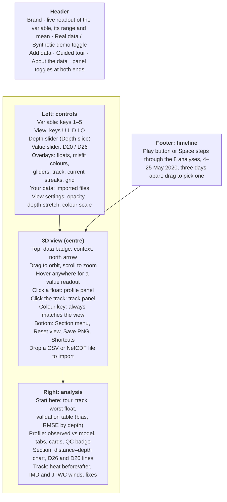
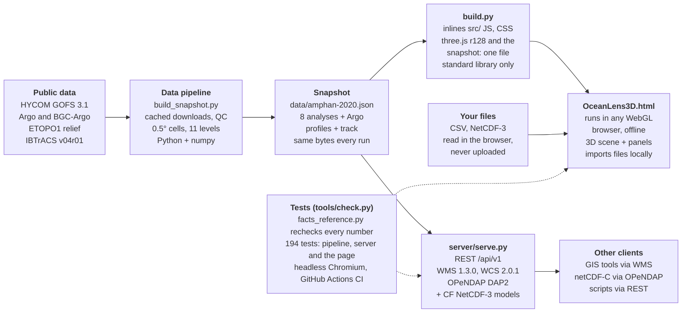

# OceanLens 3D — Presenter Guide

For the code, the tools behind it and how each part works, see [HOW_THE_CODE_WORKS.md](HOW_THE_CODE_WORKS.md).

## What OceanLens 3D is

OceanLens 3D is a browser-based 3D viewer for ocean model output and Argo float profiles over the Arabian Sea and the Bay of Bengal (6–22°N, 61–92°E, 0–1000 m). Team ByteForge built it for Smart India Hackathon 2026, problem statement 26067, whose problem owner is INCOIS.

**One-line pitch:** one HTML file that turns ocean model fields, Argo floats and a cyclone track into an interactive 3D ocean you can slice, probe and compare, with no install, server or internet.

**Say this early, and say it honestly:**

- It is a student prototype. It is not affiliated with or endorsed by INCOIS or the Ministry of Earth Sciences.
- The real-data case is a **hindcast** of Cyclone Amphan (May 2020). There are no forecasts and no live data.
- HYCOM assimilates Argo, so the model–Argo comparison is a **consistency check**, not independent validation.

**Who it is for:**

| Audience | What they get |
| --- | --- |
| Cyclone forecasters | Cyclone heat potential (TCHP) mapped with the storm track, before and after landfall |
| Oceanographers | 3D temperature, salinity, currents; depth slices, isotherm depths, sections, float profiles |
| Data managers | A data server speaking REST, OGC WMS/WCS and OPeNDAP, plus a plugin API for new instruments |
| Students and outreach | A guided 8-step tour that explains each view |

## Opening the app

Double-click `OceanLens3D.html`. That one file holds the app, three.js, the Amphan data and the coastline, so it runs from a USB stick or an email attachment with no server, install or internet.

**Before you present:**

- Use current Chrome or Edge with hardware acceleration on. Firefox and Safari 15+ should work but are untested.
- Use a laptop or desktop screen. Below 900 px wide a "Built for laptop and desktop screens" notice appears.
- If WebGL is off, the app shows a clear message instead of a blank page. Turn on hardware acceleration in the browser settings.

**The splash screen** shows the title and two buttons, which are disabled while the data loads ("Loading data…"):

- **Enter** opens the app.
- **Start the guided tour** opens the app and starts the 8-step tour.

**Two data modes**, switched in the header:

| Mode | What it shows | Labelled as |
| --- | --- | --- |
| Real data: Amphan 2020 | 8 HYCOM GOFS 3.1 analyses (12:00 UTC, three days apart), 206 QC'd Argo profiles from 70 floats, BGC-Argo chlorophyll (36 profiles, 13 floats) and oxygen (24 profiles, 9 floats), ETOPO1 relief, the IBTrACS track | "Real data" badge, real dates |
| Synthetic demo | Analytic fields with synthetic floats and gliders, including a float with a deliberate bad salinity sample | Floats SYN-F01…, gliders SYN-G1…, "demo days" not dates |

**Optional server mode:** `python server/serve.py` serves the same app at `http://127.0.0.1:8080/`. A **Data source** dropdown then appears at the top of the left panel, listing the server's datasets. Only show this if a judge asks about deployment.

## Screen tour

The screen has five parts: controls on the left drive the 3D view in the centre, and clicking in the view opens analysis on the right.

The header readout always names the current variable and depth with its range and mean, so the audience can follow what changed after every key press.

## Variables and views

Pick **what** to look at with a Variable button (keys `1`–`5`) and **how** to look at it with a View button (keys `U L D I O`). The model has 11 levels: 0, 20, 50, 75, 100, 150, 200, 300, 500, 750 and 1000 m, on 0.5° cells.

### The five variables

| Key | Variable | Unit | What to say about it |
| --- | --- | --- | --- |
| `1` | Temperature | °C | Warm surface (Bay of Bengal mostly above 30 °C on 4 May) over a sharp thermocline, cooling to about 6.5 °C by 1000 m |
| `2` | Salinity | PSU | The Bay is far fresher than the Arabian Sea at the surface (about 33 vs 36 PSU), fed by the Ganges–Brahmaputra |
| `3` | Current speed | m/s | Colour shows speed; white streaks and arrows show direction. The East India Coastal Current runs north at up to about 0.8 m/s. Streak speed is illustrative |
| `4` | Cyclone heat potential (TCHP) | kJ/cm² | Heat stored in water above 26 °C, down to the 26 °C isotherm (D26), computed in the app from temperature and salinity. The white contour marks 50 kJ/cm², a common threshold for intensification. A 2-D map, so the View buttons are hidden |
| `5` | Chlorophyll | mg/m³ | **Real mode:** HYCOM has no chlorophyll, so there is no map; the 36 BGC-Argo profiles show in the profile panel. **Synthetic mode:** a chlorophyll field is drawn, on a log scale |

### The five views

| Key | View | What you see | Extra controls |
| --- | --- | --- | --- |
| `U` | Surface | The opaque 0 m field on top, lower layers faint below; the sides of the block show the whole column | — |
| `L` | All depth levels | Every level stacked as translucent sheets | Lower-layer opacity (View settings) |
| `D` | Depth slice | One level at a time, with its own colour range | Depth slider, or `[` and `]` |
| `I` | Depth of a value | A surface showing **how deep** a chosen value sits, coloured by depth | Value slider; presets **D20** (thermocline) and **D26** (cyclone heat) |
| `O` | Isosurface (3D) | The same value drawn as a lit 3D surface, so its relief is readable | Value slider and presets |

**Columns warm to the sea floor stay open** in the Depth of a value views. Say this if a judge asks about holes over the shelf: the app does not guess a depth it cannot see.

### View settings (collapsed at the bottom of the left panel)

- **Lower layers:** opacity of the faint layers, 0–95 %.
- **Depth stretch:** vertical exaggeration; the note under it shows the ratio. The sea floor below 1000 m is compressed further.
- **Colour scale:** pick a colour ramp, switch **Linear / Log**, type a **Min / Max**, or **Reset range**. The colour key always matches what is on screen.

## Floats, profiles, sections and the Amphan story

The right panel is where the analysis happens. It shows one of four things: the **Start here** summary, a **float profile**, a **vertical section** or the **track details**.

### Start here (nothing selected)

- Three shortcut buttons: **Start the guided tour**, **Show Amphan's track**, **Compare the worst-fitting float**.
- A **regional validation summary** for the current analysis time: temperature and salinity **bias** (observed − model) and **RMSE** in three depth bands (0–100, 100–300, 300–1000 m).
- The four floats with the **largest temperature misfit**, each rated good / fair / poor. Click one to open it.
- A QC line naming any profile with a **density inversion**; flagged levels are left out of the statistics.

### Clicking a float: the profile panel

- The chart shows the **observed profile (solid)** against the **model column (dashed)**, matched in place and time.
- Tabs: Temperature, Salinity, Density, Chlorophyll, Oxygen, Current speed. Chlorophyll and oxygen only have data on BGC-Argo floats.
- Under the chart: **Bias**, **RMSE** (with a good / fair / poor word) and **levels used**.
- A depth slider (**Values at … m**) drives cards comparing observed and model **temperature, salinity, D26 and cyclone heat potential**.
- **More quantities:** density σt, sound speed (Mackenzie 1981), chlorophyll, pressure.
- A **QC badge**: density inversions found, and missing levels shown as gaps.
- Turn on **Colour floats by misfit** (Overlays) to shade every float by its temperature RMSE.

### Vertical sections

Open the **Section** menu (bottom of the 3D view), or press `S` and drag across the sea.

| Preset | Line |
| --- | --- |
| Along Amphan's track | Genesis to landfall, 200 columns |
| 15°N across the Arabian Sea | 61.5°E to 73.4°E |
| 15°N across the Bay of Bengal | 80.8°E to 91.5°E |
| 8°N across both basins | 62°E to 91.5°E |

The section appears as a curtain in 3D and as a distance–depth chart in the right panel. Hover the chart to read values. In the section chart, **solid is D26 and dashed is D20**. `Esc` closes panels, then clears the section.

### The Amphan story (real mode)

These are the numbers the app computes; the tour captions show them live.

| When | What happened | Where to show it |
| --- | --- | --- |
| 13 May 2020 analysis | Heat under the future path averaged about **85 kJ/cm²**, well above the 50 kJ/cm² mark | Variable `4`, track panel |
| 15 May, 06:00 UTC | First best-track position | Track on the map |
| 17–18 May | Rapid intensification: IMD 55 → 120 kt, JTWC 70 → 140 kt in 24 h | Track panel table |
| 18 May | Peak: IMD 130 kt (Super Cyclonic Storm), JTWC 145 kt | Track panel |
| 20 May, 10:18 UTC | Landfall near 21.7°N, 88.3°E (IMD 86 kt, JTWC 95 kt) | Track on the map |
| 22 May analysis | Heat under the path down to about **52 kJ/cm²**; the surface along the track about **2.3 °C cooler** (31.1 → 28.9 °C) while D26 stayed near 75 m: a **cold wake** | Section along the track |

**Track details:** click the track, or use **Show Amphan's track details** in the TCHP view. The panel charts heat under each fix (before vs after) and IMD and JTWC winds, with a table of every six-hourly fix.

**The timeline** at the bottom steps through the 8 analyses (4 to 25 May, three days apart). The play button, or `Space`, animates them.

## Importing real data (Add data)

Click **Add data** in the header, or drop a file on the 3D view. The file is read in the browser and **never uploaded**, a point worth saying out loud.

**What happens:**

1. Choose a file. The app detects the format and shows a review: file name, profiles found, time span, variables.
2. If some column names aren't recognised, a **Match the columns** step lets you pick them. Latitude, longitude and time are required, plus depth or pressure (surface currents need no depth).
3. Pick the **Instrument** type and a **Name in the list**, then **Add to map**.
4. The new profiles appear as markers, the timeline jumps to the nearest analysis (or **Show all times** turns on), and the first profile opens against the model column.

Imported data shows in **Real data mode only**. It is listed under **Your data** in the left panel, where it can be removed.

**Formats read:**

- CSV, tab- or semicolon-separated text, one row per sample (ERDDAP's units row is handled).
- NetCDF-3 (.nc): Argo GDAC profile files, Ifremer EGO glider files, ERDDAP tabledap downloads, CF profile data. Classic, 64-bit offset and CDF-5 variants all work.
- **Not NetCDF-4.** Convert first with `nccopy -k classic`, or export as CSV. Expect this question.

**Quality control on import:** only QC flags 1, 2, 5 and 8 are kept; for BGC data, only adjusted chlorophyll and oxygen. Glider trajectories are split into individual dives and climbs.

### Sample files to demo (in `samples/`)

| File | Real? | Good for showing |
| --- | --- | --- |
| `argo-erddap-2020-05-18.csv` | Real | **Best live demo.** Three Bay of Bengal Argo profiles during Amphan (18–19 May 2020); the 3 bad shallow samples are dropped by QC |
| `bgc-argo-2902120-c227.nc` | Real | One BGC-Argo profile with chlorophyll and oxygen (Arabian Sea, 17 May 2020) |
| `argo-5907328_prof.nc` | Real | An unmodified Argo GDAC file from an INCOIS float (Sep–Oct 2026); outside the analysis window, so Show all times switches on |
| `glider-humpback504-2016-07-05.nc` | Real | A BoBBLE 2016 Seaglider in NetCDF, split into dives |
| `glider-marlin505-2016-07-06.csv` | Real | The same experiment as CSV |
| `argo-amphan-samples.csv` | Real (processed) | Three profiles from the app's own snapshot |
| `ctd-synthetic-cast.csv` | **Synthetic** | The CTD plugin; say it is made up |

## Plugins and the data server

These two features answer "how would this scale to a real service?" Mention them briefly, and go deeper only if asked.

### Plugin API (`window.OceanLens`)

Every built-in variable and instrument is registered through the same public API that outside code uses. A new sensor or product is one more script file.

| Call | Adds |
| --- | --- |
| `registerInstrument(type, spec)` | A kind of platform: its marker, variables and panel wording |
| `registerVariable(key, spec)` | A field the app can colour by, slice and contour |
| `registerProduct(key, spec)` | A derived field, e.g. an ML output, drawn like a variable |
| `registerFormat(id, spec)` | A file format for Add data |
| `addDataset` / `removeDataset` / `on(event, fn)` | Datasets and change events |

Four example plugins ship: **CTD**, **mooring** (e.g. RAMA/OMNI buoys), **ADCP** current profiles and **HF radar** surface currents. Be honest that they are tested on **synthetic records only**; there are no real ADCP or HF radar files yet.

### Data server (`python server/serve.py`)

One Python file (standard library + numpy) serves the app at `http://127.0.0.1:8080/` and the data through four standard interfaces:

| Interface | Path | What a client gets |
| --- | --- | --- |
| REST | `/api/v1/datasets/…` | Dataset lists, one horizontal field, one water column, observed profiles, the storm track |
| OGC WMS 1.3.0 | `/wms` | Coloured PNG map tiles and point values (GetFeatureInfo) for GIS tools |
| OGC WCS 2.0.1 | `/wcs` | Raw subsets as CF NetCDF-3 or CSV |
| OPeNDAP DAP2 | `/opendap/…` | Hyperslabs for netCDF-C, Python and other scientific clients |

It also loads **CF NetCDF-3 model files** with `--netcdf`, so other model output can be served the same way.

**Limits to admit if asked:**

- The 3D view still draws only the snapshot built into the page; model files given to the server reach other clients only through REST, WMS, WCS and OPeNDAP.
- No authentication, TLS or rate limiting of its own; it belongs behind an institution's reverse proxy.
- It reads NetCDF-3; NetCDF-4 must be converted first.

## Shortcuts, the guided tour and export

### Keyboard and mouse

| Input | Does |
| --- | --- |
| `1` – `5` | Temperature, salinity, current speed, cyclone heat potential, chlorophyll |
| `U` `L` `D` `I` `O` | Surface, all depth levels, depth slice, depth of a value, isosurface (3D) |
| `[` `]` | Depth slice up / down |
| `Space` | Play / pause the analyses |
| `S` | Draw a section (drag across the sea) |
| `P` | Start / end the guided tour |
| `←` `→` | Previous / next tour step |
| `R` | Reset the camera |
| `?` | Show the shortcuts |
| `Esc` | Close a dialog, cancel drawing, close a panel, then clear the section |
| Drag / scroll | Orbit / zoom (arrow keys and `+` `−` also work when the view has focus) |
| Click a float / the track | Open its profile / the track details |

Shortcuts pause while a dialog is open, so typing in Add data won't change the view.

### The guided tour (`P`, or Guided tour in the header)

Eight steps, each setting the variable, view and time for you, with a caption of 35 words or fewer built from live numbers:

1. **Temperature:** warm surface over a sharp thermocline.
2. **One depth at a time:** the 100 m depth slice.
3. **D26, the 26 °C isotherm:** about 60–90 m across most of the Bay.
4. **Surface currents:** speed by colour, direction by streaks; the coastal current.
5. **Salinity:** fresh Bay of Bengal vs salty Arabian Sea.
6. **Heat before Amphan:** heat under the future path, track panel opens.
7. **Amphan's cold wake:** the section along the track after landfall.
8. **Argo against HYCOM:** the worst-fitting float during the storm.

Controls on the strip: **Back**, **Next**, **Autoplay** (about 3.5 words a second plus 3 s per step, at least 8 s), **End tour**. Ending the tour restores your previous view.

**Tip:** the tour is a safe fallback. If a live demo goes wrong, press `P` and let it carry the story.

### Export

**Save PNG** (bottom of the 3D view) downloads the current view with its labels, colour key and a data caveat, named by time, variable and view. Good for slides or a report.

### Other header buttons

- **About the data:** sources, methods, citations, the build version and the "read with care" caveats. Open it if a judge asks about provenance.
- The two panel toggles at the header's ends hide the left controls or the right panel for a bigger 3D view.

## How it works under the hood

A Python pipeline packs public data into one snapshot; a build script inlines it, the app code and three.js into a single HTML file; the same snapshot can also be served to other tools.

- **The app** is plain JavaScript (about 40 classic script files, no npm or framework) on three.js r128. Rendering, data, panels, import and plugins each live in their own file under `src/js/`.
- **The numbers on screen** (tour captions, About panel) are computed at runtime from the data, never typed in, and an independent Python recomputation checks them.
- **Science methods:** UNESCO EOS-80 density, Mackenzie (1981) sound speed, Leipper and Volgenau (1972) and Goni et al. (2009) for heat potential and D26, and the Argo QC manual's density-inversion test.
- **Security:** the page has a strict Content Security Policy, imported files are size-capped and parsed defensively, and the server binds to this machine only by default.

## A 7-minute demo script

Start in **Real data** mode, temperature, Surface view, at the 4 May analysis. Times are cumulative; cut the optional rows if you are short.

| Time | Do | Say |
| --- | --- | --- |
| 0:00 | Show the splash, click **Enter** | "One HTML file: no install, no server, no internet. HYCOM and Argo for Cyclone Amphan, May 2020, as a hindcast." |
| 0:30 | Drag to orbit, scroll to zoom | "Arabian Sea and Bay of Bengal, surface to 1000 m. The sides show the whole water column." |
| 1:00 | `D`, then `[` `]` through depths | "One level at a time: warm above the thermocline, about 6.5 °C by 1000 m." |
| 1:30 | `I`, click **D26** | "How deep the 26 °C water goes: the heat a cyclone can feed on. Shelf columns warm to the floor stay open; we don't guess." |
| 2:00 | `O` | "The same isotherm as a true 3D surface, from marching cubes." |
| 2:20 | `2`, `U` | "Salinity: the Bay is much fresher than the Arabian Sea, from the rivers." |
| 2:40 | `3`, `D` at 0 m | "Currents: colour is speed, streaks and arrows show direction. The coastal current runs north." |
| 3:10 | `4`, timeline to 13 May, click the track | "Heat potential before Amphan: about 85 kJ/cm² under its path, far above the 50 mark. Rapid intensification followed: IMD 55 to 120 kt in 24 h." |
| 4:00 | Timeline to 22 May, **Section → Along Amphan's track** | "After landfall the surface along the track is about 2.3 °C cooler and the heat is down to about 52: the cold wake." |
| 4:50 | `1`, close the section, **Compare the worst-fitting float** | "Argo solid, HYCOM dashed, matched in place and time, with bias, RMSE and a QC check. HYCOM assimilates Argo, so this is a consistency check." |
| 5:40 | **Add data** → `samples/argo-erddap-2020-05-18.csv` | "A real ERDDAP download, read in the browser, never uploaded. Bad samples dropped by QC; it opens against the model." |
| 6:20 | *(optional)* Synthetic demo, then back | "A synthetic ocean with known behaviour, including a float with a bad salinity sample that QC flags." |
| 6:40 | **Save PNG**; mention the server and plugins | "Exports for reports. The same data is served over REST, WMS, WCS and OPeNDAP, and new instruments plug in through one API." |

**If something breaks:** press `R` to reset the camera, `Esc` to clear panels, or `P` to run the guided tour.

## Likely judge questions

Answer honestly; the limits are documented, and owning them earns trust. Of the problem statement's 42 requirement rows in `REQUIREMENTS.md`, 20 are Met, 14 Partly met and 8 Not met.

| Question | Answer |
| --- | --- |
| Is this live or forecast data? | No. It is a hindcast of Amphan (May 2020) from 8 HYCOM analyses. Live ingestion is on the roadmap. |
| Is the model validated against Argo? | It is compared, not independently validated: HYCOM assimilates Argo, so it is a consistency check. Deep RMSE (below 300 m) is about 0.26–0.37 °C. |
| Is it real volume rendering? | Stacked translucent layers plus a marching-cubes isosurface, not ray-marched volume rendering. |
| Why no React or Vue? | Deliberate: plain JavaScript and three.js keep it to one offline file with no build chain or CDN. Marked Not met against the "modern frameworks" wording. |
| Why only to 1000 m? | The snapshot keeps 11 levels from 0 to 1000 m; the sea floor below is drawn, compressed 12×, with no data. |
| Why are the coastlines blocky? | Fields are on 0.5° cells; features smaller than that are smoothed. |
| Can it read NetCDF-4? | Not yet. Convert with `nccopy -k classic` or export CSV. NetCDF-3 (classic, 64-bit offset, CDF-5) is read in the browser. |
| Why no chlorophyll map in real mode? | HYCOM has no chlorophyll. The 36 BGC-Argo profiles are shown instead; synthetic mode draws a field. |
| Does it work on INCOIS or Copernicus data? | Not tried. The INCOIS LAS and Copernicus GLORYS are Not met; Copernicus files are NetCDF-4/Zarr and would need conversion or a new reader. |
| Search and rescue or fisheries? | Not implemented. Currents are shown but there is no particle tracking; there is no PFZ product. Both are listed as possible uses. |
| How do you know the numbers are right? | An independent Python recomputation checks every number the app shows; 194 automated tests run in a headless browser and on GitHub Actions. |
| How would it scale? | The data server speaks REST, WMS, WCS and OPeNDAP, and the plugin API adds sensors and ML products. Production would add scheduled ingestion, auth and a pipeline not tied to one case. |
| Where is the data from? | HYCOM GOFS 3.1, Argo GDAC (via Ifremer ERDDAP), ETOPO1 and IBTrACS v04r01. Full citations are in About the data. |
| Is it affiliated with INCOIS? | No. It is a student prototype, not endorsed by INCOIS or MoES. |
